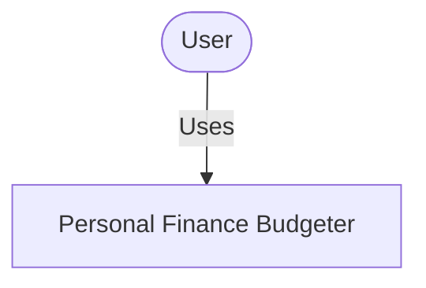
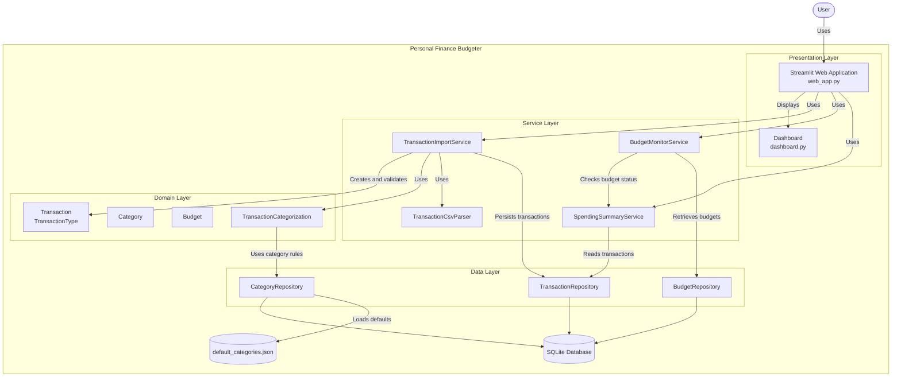
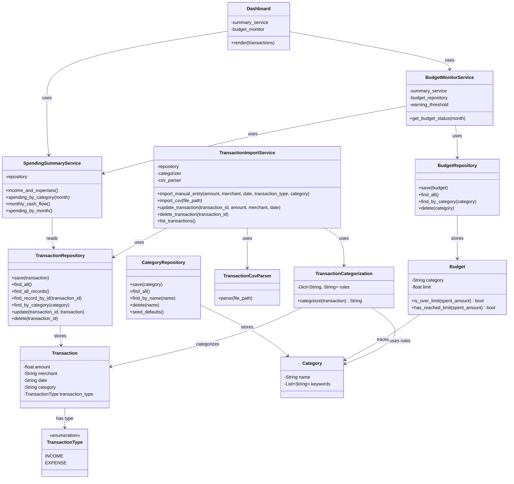
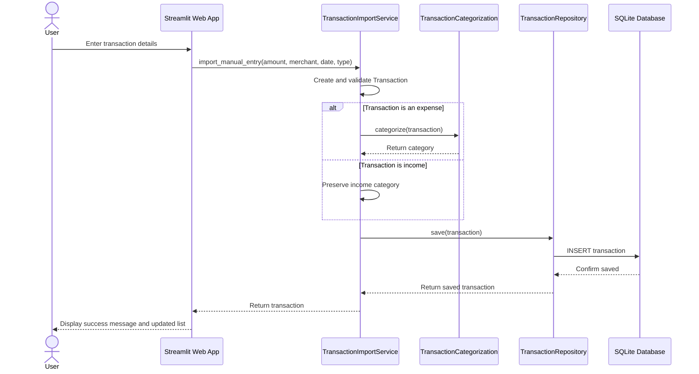

# Personal Finance Budgeter

<!-- CI badge: after Session 4, replace ORG/REPO and the workflow filename, then uncomment:

-->

**Student:** Deijen Severino · **Course:** CEN 5064 Software Design, Fall 2026 · **Partner:** @Eshim003

## Project

Project: Personal Finance Budgeter

This system is a personal finance budgeter that helps users understand and control their spending by automatically organizing transactions into categories. It is designed for individuals who want a lightweight, self-hosted way to track expenses without relying on a bank-linked app. The system supports four core features: (1) transaction import (manual entry or CSV upload), (2) a rule-based categorization engine that matches transactions to categories using keyword/merchant matching with an "Uncategorized" fallback, (3) budget limits per category with threshold alerts when spending approaches or exceeds the limit, and (4) a spending dashboard that visualizes trends over time. The system will use a layered architecture (Presentation → Service → Domain → Data) backed by a single relational database, with a minimal web UI for interaction.


## How to run

Requires Python 3.12 (the version CI uses) and Git.

### 1. Get the code and set up a virtual environment

```
git clone https://github.com/Archacez/cen5064-project-severino.git
cd cen5064-project-severino
```

### 2. Create a virtual environment

Windows (PowerShell):

```
py -m venv .venv
```

macOS:
```
python3 -m venv .venv
```

### 3. Install dependencies


Activate the virtual environment first:


Windows (PowerShell):

```
.\.venv\Scripts\Activate.ps1 
python -m pip install -r requirements.txt
python -m pip install pytest ruff
```
If PowerShell says running scripts is disabled, run `Set-ExecutionPolicy -Scope CurrentUser RemoteSigned` 


macOS:

Activate the virtual environment first:
```
source .venv/bin/activate
python -m pip install -r requirements.txt
python -m pip install pytest ruff
```

### 2. Run the app

```
cd src
python -m streamlit run budgeter/presentation/web_app.py
```

### Importing Sample Transactions

```
In Manage Transactions tab, click 'Import Transactions from CSV'.
Click 'Upload', navigate to project root and select 'sample_transactions.csv'.
Click Open, then click Import CSV.
```

### CSV format

Columns `amount,merchant,date,transaction_type`. The amount must be positive (a value like `1,234.50`
is fine), the merchant must not be blank, and the date must be a real day written as
`YYYY-MM-DD`. Rows that break these rules are skipped and counted. Transaction type column is optional.

### 3. Run the tests and linter

From the repository root (not `src`):

```
python -m pytest -q
python -m ruff check .
```


## Architecture

### Tier breakdown (Session 2 studio)

| Tier | Responsibilities in THIS system |
|------|--------------------------------|
| Presentation | [what your UI layer does] Streamlit interface and user interaction. Examples: web_app.py, Dashboard |
| Service | [what your use-case/orchestration layer does] Coordinates application workflows. Examples: TransactionImportService, SpendingSummaryService, BudgetMonitorService, TransactionCsvParser |
| Domain | [your entities and business rules] Finance concepts and business rules. Examples: Transaction, Category, Budget, TransactionCategorization |
| Data | [how and where data is stored] SQLite persistence. Examples: TransactionRepository, CategoryRepository, BudgetRepository |


### C4 — Context & Container

**Context Diagram**



**Container Diagram**



### UML — Class & Sequence

**Class Diagram**



**Sequence Diagram — Adding a Transaction**




## Architecture Decision Records

Decisions live in [`docs/adr/`](docs/adr/). Start with ADR-001 in Session 4.

| # | Decision | Status |
|---|----------|--------|
| [001](docs/adr/adr-001.md) | [Categorize transactions with keyword/merchant rules - machine learning out of scope] | [accepted] |
| [002](docs/adr/adr-002.md) | [Business rules live in the Domain; pandas only parses and cleans - duplicated validity check for manual and CSV entry, copies could drift apart] | [accepted] |
| [003](docs/adr/adr-003.md) | [Streamlit Framework Selection for Web-Based GUI] | [accepted] |

## Weekly log (optional but recommended)

A one-line note per week keeps your commit story readable:

- Week 1 (Aug 24): repo created, three ideas drafted
- Week 2 (Aug 31): ...


## Known Issues


