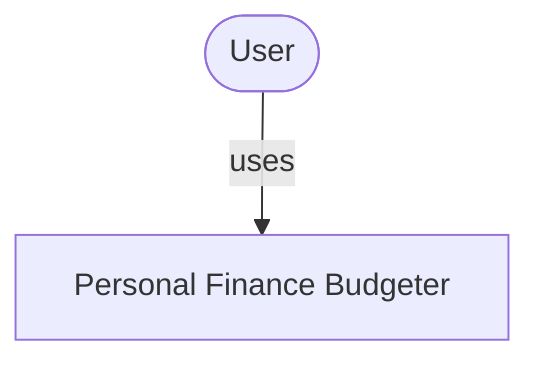
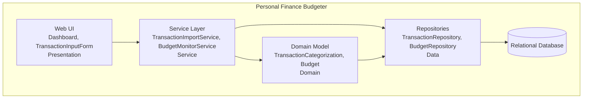
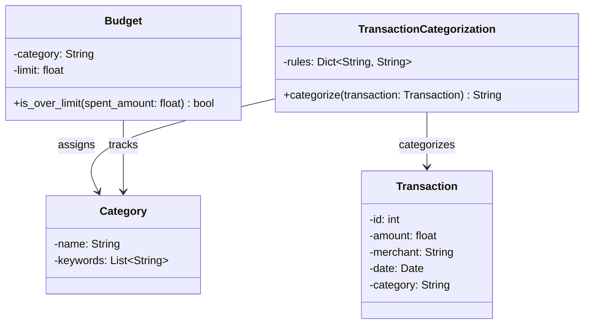
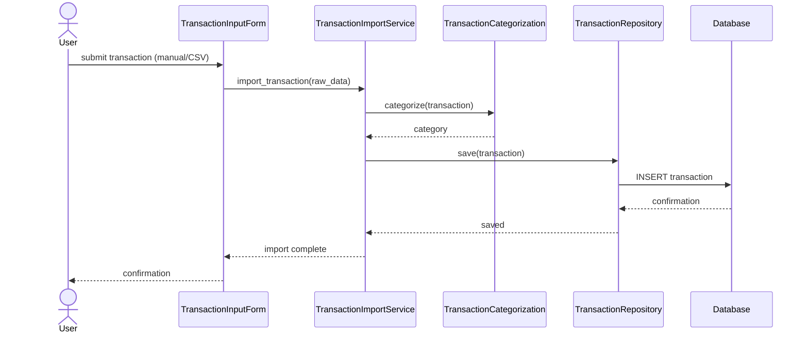

# Personal Finance Budgeter

<!-- CI badge: after Session 4, replace ORG/REPO and the workflow filename, then uncomment:

-->

**Student:** Deijen Severino · **Course:** CEN 5064 Software Design, Fall 2026 · **Partner:** @Eshim003

## Project (approval paragraph — write this by Sun Aug 30)

Project: Personal Finance Budgeter

This system is a personal finance budgeter that helps users understand and control their spending by automatically organizing transactions into categories. It is designed for individuals who want a lightweight, self-hosted way to track expenses without relying on a bank-linked app. The system supports four core features: (1) transaction import (manual entry or CSV upload), (2) a rule-based categorization engine that matches transactions to categories using keyword/merchant matching with an "Uncategorized" fallback, (3) budget limits per category with threshold alerts when spending approaches or exceeds the limit, and (4) a spending dashboard that visualizes trends over time. The system will use a layered architecture (Presentation → Service → Domain → Data) backed by a single relational database, with a minimal web UI for interaction.

## How to run

```
Requires Python 3.12 (the version CI uses) and Git.

### 1. Get the code and set up a virtual environment

```
git clone https://github.com/Archacez/cen5064-project-severino.git
cd cen5064-project-severino
```

### 2. Create a virtual environment

Windows (PowerShell):

```
py -m venv .venv
```

macOS:
```
python3 -m venv .venv
```

### 3. Install dependencies


Activate the virtual environment first:


Windows (PowerShell):

```
.\.venv\Scripts\Activate.ps1 
python -m pip install -r requirements.txt
python -m pip install pytest ruff
```
If PowerShell says running scripts is disabled, run `Set-ExecutionPolicy -Scope CurrentUser RemoteSigned` 


macOS:

Activate the virtual environment first:
```
source .venv/bin/activate
python -m pip install -r requirements.txt
python -m pip install pytest ruff
```

### 2. Run the app

```
cd src
python -m budgeter
```

A menu appears:

```
1) Add a transaction
2) Import transactions from a CSV file
3) List transactions
4) Quit
```

Try this walkthrough:

1. Choose `2` and enter `../sample_transactions.csv`. You should see
   `Imported 6 transaction(s). Skipped 1 invalid row(s).` (the sample file has one
   deliberately bad row).
2. Choose `1` and add one by hand: amount `12.50`, merchant `Starbucks`,
   date `2026-10-09`.
3. Choose `3` to list everything:

```
2026-10-01       12.50  STARBUCKS  [Uncategorized]
2026-10-02       45.20  SHELL  [Uncategorized]
2026-10-03       15.99  NETFLIX  [Uncategorized]
2026-10-04       82.31  PUBLIX  [Uncategorized]
2026-10-06        9.75  UBER  [Uncategorized]
2026-10-07      120.00  FPL ELECTRIC  [Uncategorized]
2026-10-09       12.50  Starbucks  [Uncategorized]
```

4. Choose `4` to quit, run `python -m budgeter` again, and choose `3`. Your data is
   still there, because it is stored in a SQLite file (`budgeter.db`) created in the
   folder you started the app from. Delete that file to start fresh.

Transactions are shown as "Uncategorized" for now; automatic categorization is a
later feature.

### CSV format

Columns `amount,merchant,date`. The amount must be positive (a value like `1,234.50`
is fine), the merchant must not be blank, and the date must be a real day written as
`YYYY-MM-DD`. Rows that break these rules are skipped and counted.

### 3. Run the tests and linter

From the repository root (not `src`):

```
python -m pytest -q
python -m ruff check .
```

```

## Architecture

### Tier breakdown (Session 2 studio)

| Tier | Responsibilities in THIS system |
|------|--------------------------------|
| Presentation | [what your UI layer does] "Dashboard" - Dashboard UI for spending trends, "TransactionInputForm" - plus the transaction input forms (manual entry, CSV upload) |
| Service | [what your use-case/orchestration layer does] "TransactionImportService" - Orchestrates use cases: import flow (parse → categorize → save), and "BudgetMonitorService" - budget monitoring (check transactions against budget rules, trigger alerts) |
| Domain | [your entities and business rules] "Transaction" - represents an imported transaction (amount, merchant, date, category), "Category" - represents a spending category and its matching keywords, "TransactionCategorization" - (keyword/merchant rules, uncategorized fallback) and "Budget" - Budget (limit, threshold, over-limit check) |
| Data | [how and where data is stored] "TransactionRepository", "BudgetRepository" Repositories for Transaction, Category, and Budget records against the relational database |

### C4 — Context & Container (Session 3 studio)





### UML — Class & Sequence (Session 3 studio)





## Architecture Decision Records

Decisions live in [`docs/adr/`](docs/adr/). Start with ADR-001 in Session 4.

| # | Decision | Status |
|---|----------|--------|
| [001](docs/adr/adr-001.md) | [What I am building and why] | [proposed] |

## Weekly log (optional but recommended)

A one-line note per week keeps your commit story readable:

- Week 1 (Aug 24): repo created, three ideas drafted
- Week 2 (Aug 31): ...


## Known Issues

- Importing Transactions Feature
